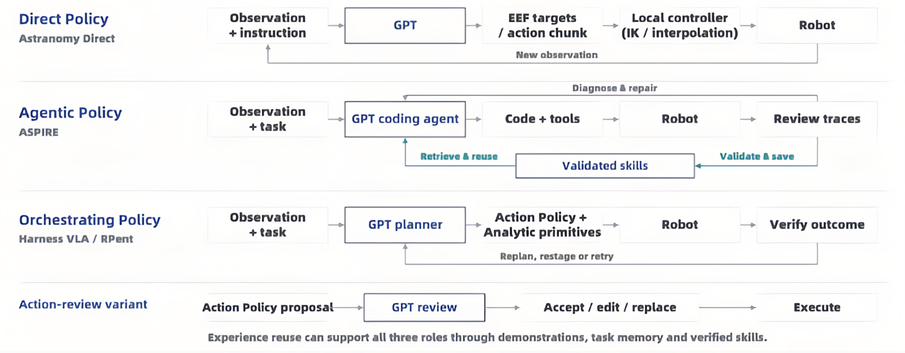

# RUA Field Notes · A field guide to robot manipulation

Given “put the can in the bin”, Astranomy asks GPT for the gripper’s next poses. ASPIRE asks a coding agent for a program that uses robot APIs; after a miss it can inspect the trace and revise that program. Both approaches use feedback. They put the decision about the next movement in different places.

[中文网站](https://cjgogo27.github.io/RUABlog/) · [English site](https://cjgogo27.github.io/RUABlog/index-en.html)

[Piper hardware study · illustrative edition](https://cjgogo27.github.io/RUABlog/piper-action-preview/en.html)

*The first two rows compare EEF feedback with program repair and skill reuse. The lower rows locate orchestration and action review.*

## Core routes

- [Direct Policy · 直接动作](chapters/zh/routes.md) · [Direct Policy](chapters/en/routes.md)
- [Agentic Policy · 程序与工具](chapters/zh/piper.md) · [Agentic Policy](chapters/en/piper.md)
  - [项目实录 · Piper 与 TERM](chapters/zh/term.md) · [Case study · Piper and TERM](chapters/en/term.md)

## Studies and further reading

- [近两个月的工作](chapters/zh/survey.md) · [Two months of RUA](chapters/en/survey.md)
- [分层执行与干预](chapters/zh/hierarchy.md) · [Hierarchy and intervention](chapters/en/hierarchy.md)
