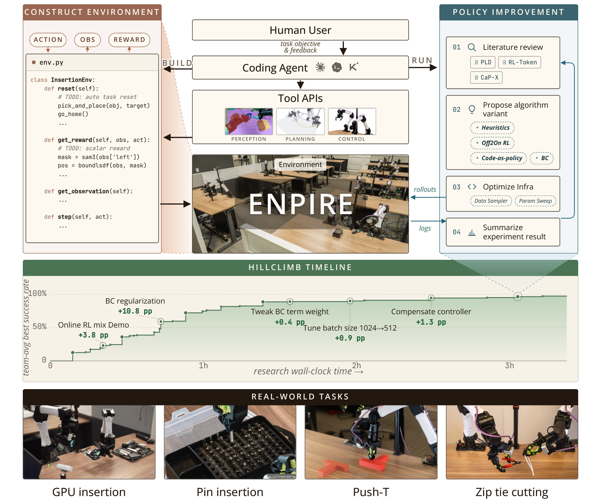

# When GPT and a VLA share a task

The can approaches the bin rim. Asking GPT to reconsider might prevent a collision, but by the time the answer arrives, the fingers may have passed the point that concerned it. Before proposing intervention, mark which part of the action sequence can still change.
## A planner sets the stage for contact
**Harness VLA / RPent** wraps a frozen VLA as a retryable primitive. The planner reads current RGB-D and task memory, binds a target and sets up the approach. Analytic routines can handle transport and pose adjustments. The VLA handles difficult contact. When a primitive returns, the planner checks a new image and decides whether to restage and retry. Repeating a missed grasp from a better viewpoint or pose is a different intervention from issuing the identical command again.

The authors’ comparison shows where this hierarchy earns its cost. On standard LIBERO, π_RLinf reached 95.3% and Harness VLA / Opus-4.7 reached 96.0%. On perturbed LIBERO-PRO the corresponding values were 50.0% and 82.4%. The same division of labour buys very different gains across the two settings. Exploration memory is part of the system; reproducing the study also means tracking the scenes used to build it. [Harness VLA pipeline and results](https://rpent.readthedocs.io/en/latest/rst_source/resources/harnessvla.html)
## Which part of the queue is still editable?
Suppose a VLA starts computing from an image at time t. The robot continues the current chunk while the next is being generated. By the time the next chunk is ready, the can may have moved. Three intervention points are worth distinguishing.

| Boundary | Mechanism | What can change |
|---|---|---|
| After a primitive returns | Planner checks the new image and rebinds the target | Next subgoal and starting pose |
| Before a new chunk is committed | Rank candidate chunks with a fresher observation | Entire uncommitted chunk |
| During a running chunk | Executor supports cancellation and a continuous handover | Cancellable, unexecuted suffix |

**RTC** predicts the next chunk while the current one runs and conditions generation on the already committed action prefix to smooth the handover. **PACT-VLA** generates candidate chunks from the earlier observation, then uses a fresher observation and the frozen policy’s flow residual to select a whole chunk before commit. On three physical tasks, the same π₀.₅ checkpoint went from 60% with naive asynchronous execution to 82%. This is a strong local alternative to asking another language model to review every step. [RTC](https://arxiv.org/abs/2506.07339) · [PACT-VLA](https://arxiv.org/abs/2610.28019)

On Piper I would first ask GPT a question at a primitive boundary: “Did the can rise with the gripper?” Its suggestion would carry the image timestamp and queue version, and expire if either is stale. The planner could change the subgoal; joint limits and rapid stops would remain local. Correct rescues, unnecessary interruptions, observation age and elapsed time would decide whether the reviewer adds anything over a local visual check. This is a proposed experiment.
## ENPIRE works on a different clock
The preceding loops decide how the current attempt proceeds. **ENPIRE** joins scene reset, physical execution, verification and policy refinement into an experimental loop. The next decision might change the policy for the next run. Its showcased 99% uses pass@8: a subtask in one long rollout gets up to eight retries conditioned on previous failures. That measures sustained recovery. For first-grasp reliability, look separately at pass@1 and how much time the subsequent attempts consume. [ENPIRE evaluation and retry definition](https://research.nvidia.com/labs/gear/enpire/)

*The environment handles reset and verification, policy improvement produces candidates, robots run trials, and the coding agent uses the results to guide the next revision. · [Xiao et al., ENPIRE, Figure 2](https://arxiv.org/html/2606.19980v2#S0.F2)*

[中文](../zh/hierarchy.md) · [English](../en/hierarchy.md)
