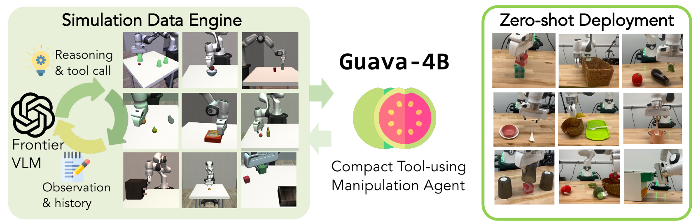
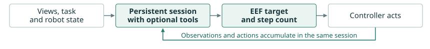
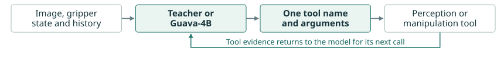
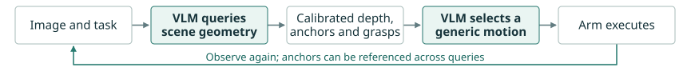
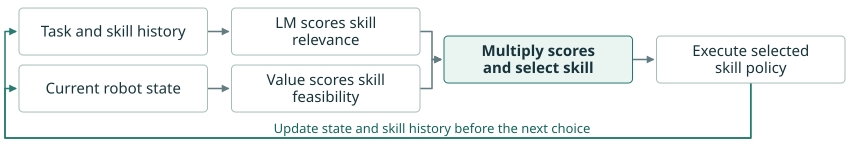
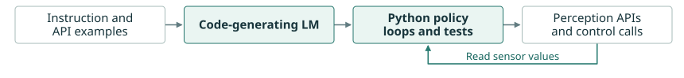
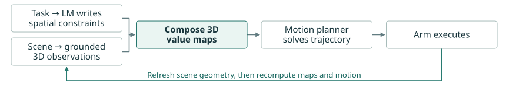
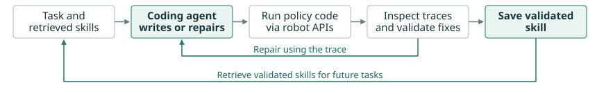
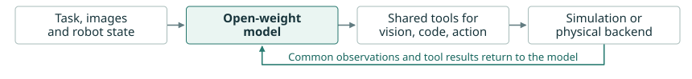

# Agentic Policy: choosing tools and writing programs

The gripper has closed; the can is still on the table. If the last call returned only “done”, the model may now request a move to the bin. Tool design starts with two questions: who handles localization and approach, and what evidence can the tool return about the grasp?
**Two execution schedules recur here.** Guava asks the model for another decision after each tool returns. ASPIRE can encode perception, branches and retries in a program. That program calls perception and motion APIs during the rollout; between attempts the coding agent reads traces, diagnoses the failure and revises the code. Validated skills can be retrieved later. As you read, track whether feedback reaches the model now, a running program, or the next round of skill development. [Guava](https://guava-harness.github.io/) · [ASPIRE](https://research.nvidia.com/labs/gear/aspire/)

## Which skill is feasible here?
**SayCan** scores each candidate skill twice. A language model estimates whether the skill fits the instruction, and a learned value function estimates whether it can succeed from the current state. The system combines the scores, executes a skill and selects again. Fetching the can might be semantically appropriate even when the bin blocks access. The authors report that PaLM-SayCan chose the correct skill sequence 84% of the time and executed tasks successfully 74% of the time. The ten-point separation is a reason to measure planning and physical execution separately. [SayCan method and results](https://say-can.github.io/)
## Tool granularity sets the observation schedule
**Guava** gives teacher and student a common set of perception and manipulation tools. A model decision selects a tool and arguments, then receives an updated image, gripper state or execution feedback. For the can, a candidate sequence is “locate → align → grasp → check → transport”. A miss at grasp time invalidates the rest of that sequence.

*The teacher collects interactions through tools in simulation. The trained student uses the same interface at deployment. · [Guava project page](https://guava-harness.github.io/#overview)*

In the authors’ harness study on seven tasks with fifteen trials each, GPT-5.4 achieved 56.2% with images alone, 77.1% with images plus gripper state, 88.6% with the full single-action replanning interface, and 82.9% with multi-action replanning. The first comparison tests missing state; the second tests the feedback schedule. A real rollout makes the distinction tangible. The can contacted the bin rim and the controller interrupted motion. The agent used that return to move sideways before it resumed placement. [Guava ablations and recovery](https://guava-harness.github.io/)

**K1 moves more work into perception tools.** The agent queries calibrated depth, persistent anchors, measurements and grasp hypotheses before choosing generic motions. On matched LIBERO-PRO tasks, the same Astra scored 61.1% with an RGB harness and 88.9% with K1. This varies a package of perception capabilities. It suggests a narrower Piper experiment: fix the model, scenes and retry budget, vary target binding alone and count how often a neighbouring object is grasped. [Robo-Harness K1](https://arxiv.org/abs/2609.29389)
## When the model returns code
Consider a missed grasp as a teaching example. A tool agent might issue three successive calls: locate the can, grasp it, locate it again. The third call is generated only after the miss. A code agent might have already written a branch that changes the viewpoint and reruns localization if the can stays on the table after lifting. Both use feedback. One calls the model at the point of failure; the other runs a previously generated condition there. Comparing their response times requires timing both model waits and the robot movements needed to check the condition.

**Code as Policies** translates an instruction into a program that calls perception and control APIs. A program handling several cans can loop, branch and compute geometry locally. **VoxPoser** uses code for a different intermediate product. With visual grounding, the code builds 3D value maps for goals and constraints such as approaching a handle while avoiding a cup. A motion planner searches for an end-effector trajectory using those maps. Both generate code; control flow in one case and a spatial objective in the other are what the executor actually receives. [Code as Policies](https://code-as-policies.github.io/) · [VoxPoser](https://voxposer.github.io/)

**ASPIRE** adds a learning loop around the program. It reads a failed call, the return and visual evidence, edits the program, validates it on new executions and stores a retrievable skill. A later robot must still bind that skill to the geometry in front of it. In cross-embodiment experiments, the authors report both the tokens needed to reach a first working physical program and that program’s held-out success. These measure debugging cost and reuse quality, respectively. [ASPIRE experiments and limitations](https://research.nvidia.com/labs/gear/aspire/)

## Comparing robot-use agents
After a missed grasp, Guava’s model reads a tool result, a Code as Policies program can take a conditional branch, and ASPIRE’s coding agent can revise the program after a trial. Trace which component receives the evidence in each figure. SayCan is an early skill-selection reference using PaLM. OpenRUA uses Claude Code, and uni-robot-agent demonstrates the interface with open models.

### What does the model decide in one turn?

**Astranomy · Agentic** · [Primary source](https://research.nvidia.com/labs/srl/projects/astranomy/)

This is the EEF configuration. It retains a geometric action interface, while the decision session persists across attempts and can inspect images or run calculations.

**Guava** · [Primary source](https://guava-harness.github.io/)

An alignment result only establishes alignment. The model reads the return before it can decide to close the gripper. Teacher and student share the tool interface.

**Robo-Harness K1** · [Primary source](https://arxiv.org/abs/2609.29389)

A geometry query can leave the arm still. The agent can refer to the same visual anchor, inspect size or depth, and only then choose an approach.

**SayCan** · [Primary source](https://say-can.github.io/)

The skill vocabulary is fixed. A grasp can be a good linguistic continuation and still lose to another skill when its feasibility in the current state is low.

### What executes the generated program?

**Code as Policies** · [Primary source](https://code-as-policies.github.io/)

The generated program can query a detector until a condition holds. This feedback runs inside the program and reuses the same code at each check.

**VoxPoser** · [Primary source](https://voxposer.github.io/)

Approach the handle and avoid the cup can be represented as separate maps. A planner acts on their composition; updated geometry can reuse the same program.

**ASPIRE** · [Primary source](https://research.nvidia.com/labs/gear/aspire/)

The two returns operate at different times. A trace can repair the current program. A validated repair can enter the skill library for retrieval on a later task.

**OpenRUA** · [Primary source](https://arxiv.org/abs/2610.02459)

The interface is a documented workspace. The agent organizes observation scripts, ROS 2 commands and retries using its terminal.

**uni-robot-agent** · [Primary source](https://arxiv.org/abs/2611.01560)

OpenRUA starts from native ROS 2. This work standardizes tools across backends. In a no-depth example, the agent triangulates from multiple views using calibration and its own code.

[Case study · Piper and TERM](term.md)

[中文](../zh/piper.md) · [English](../en/piper.md)
