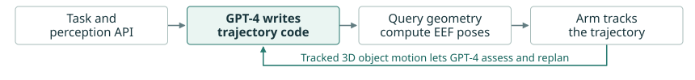
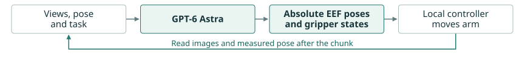
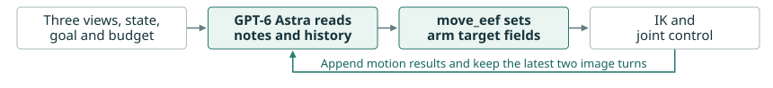
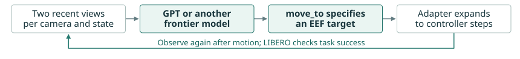
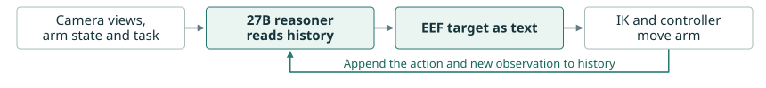

# Direct Policy: GPT emits end-effector actions

Move the can two centimetres to one side and take another picture. Which numbers in the model’s next response should change? That question separates two implementations commonly described as direct robot control.
## The six quantities in a pose
The end effector (EEF) here is the gripper. Its spatial position and orientation have six degrees of freedom, with a separate value commonly controlling the fingers. An overhead grasp might start with a target above the can with open fingers, followed by descent and closure. To execute those instructions numerically, the receiver needs a frame, an absolute target or a displacement, units and a rotation convention.

A typical path is **image and instruction → EEF target → inverse kinematics → joint tracking → new image**. It contains two feedback loops. The controller uses encoders to reduce tracking error. The model uses a later image to see whether the task progressed. If the arm reached the old target after nudging the can out of the way, both “target reached” and “grasp missed” are accurate reports.

**Astranomy exposes this division of labour.** It evaluates GPT-6 Astra generating actions directly, operating as an agent with persistent history, and reviewing actions proposed by another policy. On RoboLab-120 these settings scored 66.3%, 74.8% and 66.5%. The agent beat direct generation by 8.5 points. Its ablations found value in history and no further gain from adding tools within the agentic setting. Remembering the last failed attempt matters when interpreting the headline comparison. [Authors’ study, prompts and replays](https://research.nvidia.com/labs/srl/projects/astranomy/)
One published Astranomy Direct prompt specifies eight values per row: three root-frame coordinates, a unit quaternion and a gripper command. The policy emits 3–15 absolute targets. Each row runs for one interval at 15 Hz, after which the updated views and measured pose return at the next replan. The pose refers to the gripper flange; targeting the finger pads requires an offset. The message happens to be delivered through a function call, yet GPT still chooses every pose. Reading the payload is more informative than counting tool names. [Published Astranomy action protocol](https://research.nvidia.com/labs/srl/projects/astranomy/)

## Can the model learn without expert actions?
**PEAR** lets an open 27B reasoning model attempt simulated tasks. It emits end-effector actions, the simulator executes them, and task rewards train the model. The approach replaces per-step expert labels with simulation attempts and a reward that must reflect the intended behaviour. The authors report 1.6% to 74.4% on LIBERO and 0% to 60% on their physical dual-arm trials. This is one documented recipe for training an embodied reasoning model. A closed GPT service’s training data cannot be inferred from an API demo. [PEAR research blog](https://mit-han-lab.github.io/pear-blog/)

**Back to the can.** If the fingers consistently miss to the right, project the model’s EEF target back into the camera image. A misplaced projection suggests a localization or frame error. A correct projection that the fingers never reach suggests checking reachability and control. A final frame of an empty grasp cannot distinguish the two.
## How does GPT turn an observation into an end-effector target?
The tinted boxes mark decisions and outputs. Follow the return arrow to see when the model can correct a miss. To pick up a bowl, one system can compute a whole trajectory and inspect the bowl’s motion afterwards. Another can issue one target and look again before continuing. Both may reach the same pose, with different opportunities to change course.

### GPT specifies the motion geometry

**Language Models as Zero-Shot Trajectory Generators** · [Primary source](https://www.robot-learning.uk/language-models-trajectory-generators)

GPT-4 writes Python that computes the trajectory itself. In the bowl example, tracked object motion reveals a failed grasp and prompts a different grasp point on the next attempt.

**Astranomy · Direct** · [Primary source](https://research.nvidia.com/labs/srl/projects/astranomy/)

In one published prompt the model writes 3–15 absolute targets per call. If the can shifts, the next query can revise the targets.

**RoboProbe · An Unexpected Robot Policy** · [Primary source](https://arxiv.org/html/2609.24170v1#S3)

The model may update a subset of target dimensions or end the episode. Although a function call carries the motion, GPT chooses its geometric target.

**LLM-LIBERO · From Reasoning to Action** · [Primary source](https://irvlutd.github.io/LLM-LIBERO/)

There is one motion command alongside done and give_up. A single call can consume several control steps, so model queries and simulator steps measure different things.

### An open reasoning model with the same interface

**PEAR · Qwen3.8-27B** · [Primary source](https://mit-han-lab.github.io/pear-blog/)

PEAR and Astranomy Direct both emit EEF targets. PEAR learns this interface through task-outcome rewards in simulation and predicts the next pose from observations at deployment.

[中文](../zh/routes.md) · [English](../en/routes.md)
