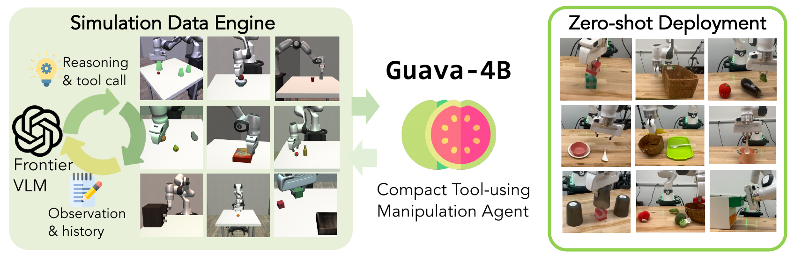
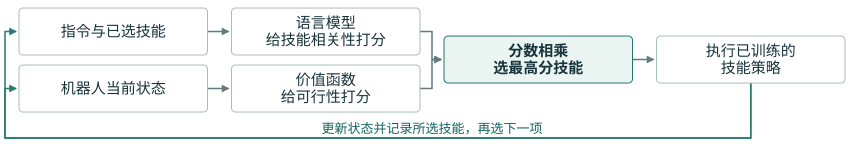
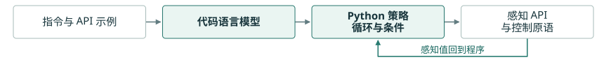
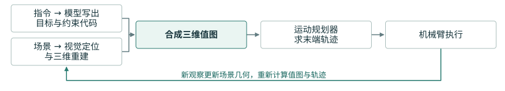
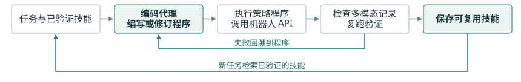

# Agentic Policy：模型调用工具，也能写程序

夹爪已经合上，罐子还在桌上。如果上一条命令只返回“执行完成”，模型下一步很可能直接去箱子。工具路线的核心设计问题是：谁负责定位和接近，工具又凭什么告诉模型这次抓取发生了什么？
**这条路线有两种常见执行节奏。** Guava 的模型在每次工具返回后决定下一次调用。ASPIRE 的编码代理可以把观察、分支和重试写成程序；运行时由程序调用感知和运动 API，跨次尝试时代理再读日志、诊断和修复。经过验证的技能可供以后检索。读下面的对照时，留意当前场景的反馈回到了模型、程序，还是下一轮技能开发。[Guava](https://guava-harness.github.io/) · [ASPIRE](https://research.nvidia.com/labs/gear/aspire/)

## 技能库先解决“这台机器做得到吗”
**SayCan** 把候选技能放在两把尺子下衡量。语言模型估计哪个技能接得上任务，技能自己的价值函数估计在当前状态能否完成。系统合并两个分数，执行选中的技能，再对剩余任务重新选择。比如箱子挡住去路时，“把罐子拿来”语义完全合理，可执行性却可能很低。论文作者报告 PaLM-SayCan 选对技能序列的比例为 84%，实际执行成功为 74%。这十个百分点提醒我们，正确计划和可完成动作要分别看。[SayCan 方法与实验](https://say-can.github.io/)
## 工具的粒度决定下一次观察在哪里
**Guava** 把感知、定位和操作包装成一套教师和学生都能用的接口。一次模型决策选择一个工具并填参数，工具执行后返回图像、夹爪状态或反馈，模型据此继续。可以把抓罐任务理解为“查罐子位置 → 对齐 → 抓取 → 检查 → 搬运”。具体执行时，不应在发出抓取前就把后面的几个动作当作必然会发生。

*教师在仿真中通过工具采集交互，学生训练后通过同一接口部署。 · [Guava 作者项目页](https://guava-harness.github.io/#overview)*

原论文在七个任务、每任务 15 次的接口实验中，用 GPT-5.4 只看图像时成功率 56.2%，加夹爪状态后 77.1%，完整接口且每次动作后重规划为 88.6%，改为多动作后重规划为 82.9%。四行各有用途：前两行问“模型缺了哪种状态”，后两行问“把反馈推迟会怎样”。作者还展示过罐子碰到箱沿触发控制器中断，策略依据反馈先横移，再继续放置。这段回放比一句“有恢复能力”更能说明接口的作用。[Guava 接口消融与失败恢复](https://guava-harness.github.io/)

**K1 把工具向感知一侧推进。** 代理可以查询标定深度、持久视觉锚点、空间尺寸和抓取假设，再选通用运动。在匹配的 LIBERO-PRO 条件下，同一个 Astra 采用 RGB 接口为 61.1%，接入 K1 为 88.9%。这里变化的是整套感知接口。它给 Piper 一个实际可做的对照：保持模型、场景和重试数固定，只改变目标绑定方式，先数清抓错相邻物体的次数。[Robo-Harness K1](https://arxiv.org/abs/2609.29389)
## 当模型输出一段代码
下面用同一次抓空做个教学例子。工具代理可能连续产生三次调用：定位罐子、抓取、重新定位；第三次调用只有在看到抓空后才生成。代码代理则可以事先生成“若抬起后罐子仍在桌上，就换观察位再定位”的条件分支。两者都能闭环。前者在失败处重新请模型做决定，后者在失败处执行已经写好的判断。要比较响应速度，得分别测模型等待时间和机器人执行这些检查的时间。

**Code as Policies** 让语言模型把指令翻译成调用感知和控制 API 的程序。对于一组罐子，循环、条件判断和几何运算可以在本地反复执行。**VoxPoser** 选择了不同的中间产物：模型生成代码，借视觉定位把“靠近把手”“避开杯子”等意图写成三维值图，运动规划器再沿值图搜索末端轨迹。前者让模型组织控制逻辑，后者让模型描述空间目标与约束。两者都可能写代码，真正决定复现方法的是代码最后交给执行器的对象。[Code as Policies](https://code-as-policies.github.io/) · [VoxPoser](https://voxposer.github.io/)

**ASPIRE** 在程序外又加了一轮学习：读取某次失败的调用、返回和视觉证据，修改程序，复跑验证，再把修复保存成可检索技能。面对新物体，检索到的旧方法仍得用当前几何重新落地。在其跨机器人实验里，作者分别记录首次写出成功真机程序所用的 token，以及该程序在留出试验中的成功率。一个衡量调试成本，另一个衡量复用质量。[ASPIRE 实验和局限](https://research.nvidia.com/labs/gear/aspire/)

## 工具代理的结构对照
同样是抓空，Guava 的模型读一次工具返回，Code as Policies 生成的程序可以直接走条件分支，ASPIRE 的编码代理还可以在试验后改写程序。这三种回路的接收方分别是模型、正在运行的程序和下一版程序。图中的 SayCan 是技能选择的早期参照，使用 PaLM；OpenRUA 使用 Claude Code，uni-robot-agent 展示开放模型。同类接口可以由不同模型实现。

### 模型在一次交互中决定什么？

**Astranomy · Agentic** · [作者原文](https://research.nvidia.com/labs/srl/projects/astranomy/)

图中取末端控制配置。它与 Direct 共用相似的动作表达，关键变化是决策会话保留此前尝试，代理还可以按需检查图像或计算几何。

**Guava** · [作者原文](https://guava-harness.github.io/)

一次对齐只说明工具完成了对齐。模型在下一轮可以读反馈，再决定是否闭合夹爪。教师采集与学生部署使用同一组工具。

**Robo-Harness K1** · [作者原文](https://arxiv.org/abs/2609.29389)

几何查询本身可以不移动手臂。抓取前，模型可以引用同一个视觉锚点，检查尺度或深度，再决定怎么接近。

**SayCan** · [作者原文](https://say-can.github.io/)

候选技能先定好。即使语言模型认为“抓罐”最符合任务，当前状态的可行性分数也可以让另一项技能胜出。

### 生成的程序究竟交给谁执行？

**Code as Policies** · [作者原文](https://code-as-policies.github.io/)

生成程序可以反复读取检测结果，直到满足条件才调用下一步。这样的反馈循环在本地程序内运行，每次判断都可复用已经写好的代码。

**VoxPoser** · [作者原文](https://voxposer.github.io/)

“接近把手”和“远离杯子”可各写成一张图。两图合成后由规划器求动作，场景变化时可以重算几何而复用同一段代码。

**ASPIRE** · [作者原文](https://research.nvidia.com/labs/gear/aspire/)

两条回路作用于不同时间。一次失败的视觉和调用记录帮助修改当前程序；通过复测的修复可进入技能库，供以后的任务检索。

**OpenRUA** · [作者原文](https://arxiv.org/abs/2610.02459)

这里交给代理的是带文档的工作区。采用哪段观察程序、发哪个 ROS 2 命令、怎样组织重试，均由代理在工作区中安排。

**uni-robot-agent** · [作者原文](https://arxiv.org/abs/2611.01560)

OpenRUA 从原生 ROS 2 起步，这项工作统一了不同后端的工具协议。论文的无深度实例中，代理用多视角像素、相机参数和自写代码三角定位。

[项目实录 · Piper 与 TERM](term.md)

[中文](../zh/piper.md) · [English](../en/piper.md)
